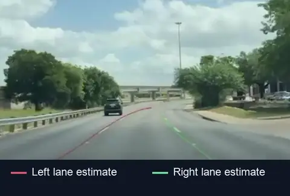
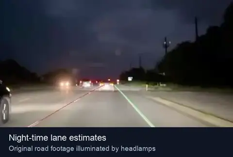
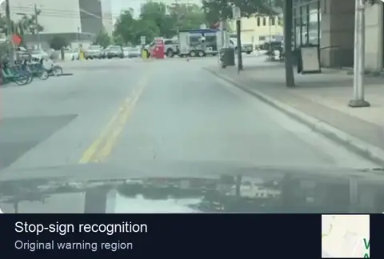
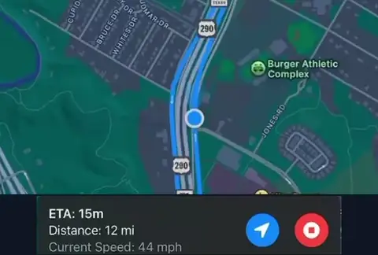
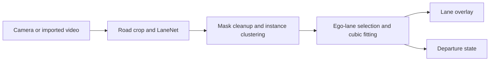

<div align="center">

# ADAS for iOS

### On-device lane perception and navigation

**A native iOS research prototype combining navigation, Core ML and custom Metal compute.**

Oliver Paver · The University of Manchester · BSc Computer Science · 2025

[Demonstration](#demonstration) · [System](#how-the-system-works) · [Build](#build-and-first-run) · [Documentation](#documentation)

<table>
<tr>
<td width="50%" align="center">
<strong>Daylight lane tracking</strong><br>
<a href="https://github.com/OliverPaver/adas-ios/raw/refs/heads/main/assets/demo/daylight.mp4"></a><br>
<sub>Curves and changing lane geometry · 20 seconds</sub>
</td>
<td width="50%" align="center">
<strong>Night-time lane tracking</strong><br>
<a href="https://github.com/OliverPaver/adas-ios/raw/refs/heads/main/assets/demo/night.mp4"></a><br>
<sub>Low-light road footage · 12 seconds</sub>
</td>
</tr>
<tr>
<td width="50%" align="center">
<strong>Stop-sign recognition</strong><br>
<a href="https://github.com/OliverPaver/adas-ios/raw/refs/heads/main/assets/demo/stop-sign.mp4"></a><br>
<sub>Camera view and original warning region · 10 seconds</sub>
</td>
<td width="50%" align="center">
<strong>Live navigation</strong><br>
<a href="https://github.com/OliverPaver/adas-ios/raw/refs/heads/main/assets/demo/navigation.mp4"></a><br>
<sub>Route tracking, GPS speed and controls · 20 seconds</sub>
</td>
</tr>
</table>

**Click a panel to download its MP4.** Each preview loops independently.

</div>

## Demonstration

These excerpts show the original **2025 application recording**, including its
actual lane estimates and warning behavior. Daylight perception and navigation
show the same drive; the night and stop-sign panels show separate excerpts.
The stop-sign panel includes the historical warning icon, whose UI invocation
is disabled in the current source. The [media guide](docs/DEMO.md) records the
source timestamps, crops and differences from the current app.

## Project overview

This project investigates how a standard iPhone can combine navigation with
camera-based road perception, using its built-in camera and native machine-learning
and graphics APIs. The engineering challenge is to turn neural-network outputs
into useful lane geometry while sharing mobile compute resources with capture,
mapping and presentation.

The implementation combines learned segmentation and pixel embeddings with
classical image processing, density clustering and robust curve fitting. It is
written in **Swift and Metal**: Core ML runs the bundled LaneNet and stop-sign
models, custom Metal kernels handle parts of the lane post-processing, and
SwiftUI presents the result alongside MapKit navigation. A separate video mode
runs the lane pipeline on a recording imported from Photos.

The work was developed for the dissertation *Advanced Dynamic Road Hazard
Detection with Navigation on a Mobile Platform*. The
[design and report notes](docs/REPORT_ALIGNMENT.md) connect its objectives to the
retained implementation and distinguish historical descriptions from current code.

## What the project implements

- **Lane perception from a monocular camera.** LaneNet identifies lane pixels and
  provides embeddings that the application groups into individual lane instances.
- **Custom CPU/GPU post-processing.** Mask cleanup, Metal density clustering,
  batched cubic RANSAC scoring and overlay rendering turn model outputs into
  left- and right-lane estimates.
- **Lane-departure heuristics.** Learned image-space lane width, center calibration
  and a debounced offset check produce a warning state.
- **Stop-sign model integration.** A Create ML detector runs through Vision in
  the live-camera path and publishes a detection state.
- **Native application integration.** Camera capture, Photos video import,
  destination search, route tracking and GPS speed display share one iOS interface.

LaneNet supplies the pretrained segmentation/embedding network. The project work
includes its TensorFlow-to-Core-ML conversion, iOS integration, post-processing
and GPU kernels, warning logic, sign-model workflow and application integration.
It does not claim authorship of LaneNet or BiSeNet V2. See
[model provenance](docs/MODELS.md) and [source provenance](PROVENANCE.md).

## How the system works

### From camera pixels to lane curves



| Stage | What happens | Execution |
| --- | --- | --- |
| Prepare the image | Crop the bottom 60% of the frame, resize to 512 × 256 and normalize RGB to `[-1, 1]`. | CPU |
| Infer lane pixels | LaneNet produces a binary lane mask and **four embedding values per pixel**. | Core ML |
| Clean the mask | Apply 5 × 5 dilation/erosion and remove connected components smaller than 100 pixels. | CPU / Accelerate |
| Separate lane instances | Find dense core points in embedding space and propagate labels through ten passes. | Metal |
| Select and fit the ego lane | Choose the nearest lower-image cluster on each side; generate cubic hypotheses, score inliers and refine the best fit. | CPU sampling/solving, Metal scoring, CPU least squares |
| Render the result | Rasterize curve segments, write colored points into a texture and composite the overlay onto the camera image. | CPU + Metal |

The fitting stage uses `y = Ax³ + Bx² + Cx + D`. For each selected lane cluster,
it targets 200 solvable RANSAC hypotheses in batches of 50. Metal scores each hypothesis against the lane points,
and CPU code refits the winning inliers. This preserves curved lane geometry
without treating every segmented pixel as part of the final boundary.
The clustering is a custom **DBSCAN-style core-point implementation**, with fixed
label-propagation passes and unassigned non-core points. The
[architecture guide](docs/ARCHITECTURE.md#lane-pipeline) explains those semantics
and maps each stage to its source file.

### Frame scheduling on a mobile device

Capture and lane inference are decoupled. A new frame replaces the pending frame,
while the display combines the current image with the most recently available
overlay. The pending queue holds one frame, allowing newer input to replace work
that has not started. It does not mean that every displayed frame receives a new
inference result. Overlay/geometry synchronization and cancellation remain
[documented limitations](docs/LIMITATIONS.md#coordinate-and-state-consistency).

### From lane geometry to a warning

Departure monitoring works in the 512 × 256 model image. It samples the fitted
curves at rows 180 and 200, learns lane width from stable observations and uses
that width when one boundary is missing. After 20 qualifying updates, the mean
lane midpoint calibrates the initial image-center estimate.

The offset check compares the lane midpoint with that calibrated center. Its
threshold is 0.4 times the lane half-width, followed by a five-call debounce.
These are image-space heuristics, not a calibrated lateral distance or a fixed
warning delay: repeated calls can use the same inference result. Exact constants
are listed in [configuration](docs/CONFIGURATION.md).

### Stop signs and navigation

The live processor runs the stop-sign model every third camera callback. Vision
returns detections, and the application accepts the trained label `"3"` at a
confidence of at least 0.5. The live processor publishes a Boolean state; its visible
navigation indicator is currently disabled. The historical clip above shows
that indicator in the original demonstration build.

MapKit supplies place autocomplete, automobile routes and the route overlay.
The app selects the returned route with the shortest expected travel time,
displays Core Location speed in mph and requests a new route when the position
is more than 50 metres from its polyline. Starting navigation reveals the camera
panel; stopping it returns to search. Perception runs on-device, while map search
and directions use Apple services.

An experimental human/animal path also tests bounding-box bottom-centers against
a lane corridor. Its model-space/full-frame coordinate mismatch is unresolved,
so it is presented as an implementation experiment rather than validated
collision prediction.

## Current scope

| Capability | Navigation / live camera | Imported video |
| --- | --- | --- |
| Lane overlays | Implemented | Implemented |
| Lane-departure state | Implemented | Implemented |
| Stop-sign detection | Runs; visible indicator disabled | Not connected |
| Human/animal lane-corridor heuristic | Experimental; coordinate mapping needs correction | Not connected |
| Map search, route tracking and GPS speed | Implemented | Not applicable |

This is a research prototype, not a validated road-safety system. Fixed image-space
assumptions, result synchronization, orientation handling and test quality limit
what can be concluded from a successful demonstration. No current accuracy,
throughput or coverage benchmark is claimed. Read the
[limitations](docs/LIMITATIONS.md) for the specific implementation constraints.

## Build and first run

The project targets **iOS 18.2+**. Simulator Release builds have been verified with
**Xcode 16.4 (16F6)** locally and on GitHub Actions. There are no external runtime
package dependencies. Both model artifacts are included and checked against
[their manifest](MODEL_MANIFEST.json).

```bash
git clone https://github.com/OliverPaver/adas-ios.git
cd adas-ios
python3 scripts/verify_models.py
bash scripts/build.sh simulator
open Video_Lane_Test.xcodeproj
```

The Xcode project and scheme retain the name `Video_Lane_Test`. For an iPhone,
select your own signing team and unique bundle identifiers. Choose **Video** and
import a road video from Photos to exercise the lane pipeline. The **Image** tab
contains navigation and the live camera view, which appears after a route starts.

The signed app was installed and launched on an **iPhone 16 Pro Max with iOS
27.0.1**. The owner confirmed live preview, the navigation stop control and
advancing imported video with lane overlays on the pre-maintenance baseline.
The final maintained app was rebuilt, installed and launched successfully.

All **16 enabled unit/integration tests passed** on an iOS 18.2 Simulator with
Xcode 16.4. The suite includes smoke tests and weaker placeholder/timing-dependent
checks; UI tests remain disabled in the original test plan. GitHub Actions checks
model integrity and the Simulator build, not the test suite. The
[validation record](docs/VALIDATION.md) separates those results and their limits.
Follow [setup](docs/SETUP.md) for signing, permissions and troubleshooting.

## Documentation

| Guide | Contents |
| --- | --- |
| [Architecture](docs/ARCHITECTURE.md) | Runtime flow, source map, tensors and CPU/GPU responsibilities |
| [Design and report notes](docs/REPORT_ALIGNMENT.md) | Project motivation, engineering choices and dissertation/code distinctions |
| [Configuration](docs/CONFIGURATION.md) | Original thresholds, dimensions and timing controls |
| [Setup](docs/SETUP.md) | Toolchain, models, signing, first run and troubleshooting |
| [Models](docs/MODELS.md) | Artifact identities, preprocessing, labels and provenance |
| [Validation](docs/VALIDATION.md) | Executed checks, results and remaining verification |
| [Demonstration](docs/DEMO.md) | Historical footage, editing boundaries and reproduction |
| [Limitations](docs/LIMITATIONS.md) | Known behavioral and evaluation constraints |
| [Provenance](PROVENANCE.md) | Original project and preparation of this source snapshot |

## Attribution and licensing

Developed by Oliver Paver at The University of Manchester under Dr Terrence
Morley's supervision. The lane model is attributed to
[MaybeShewill-CV's LaneNet implementation](https://github.com/MaybeShewill-CV/lanenet-lane-detection),
which implements the LaneNet instance-segmentation approach with a BiSeNet V2 option.

The identified stop-sign training dataset is listed under CC BY 4.0 and credited
in the [third-party notices](THIRD_PARTY_NOTICES.md). The TuSimple test image is
attributed under Apache 2.0. The author-confirmed LaneNet conversion carries the
upstream Apache 2.0 attribution and a [conversion notice](MODEL_NOTICES.txt).
The source, models and media are not assigned a blanket redistribution licence.
