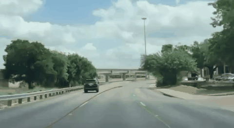

<div align="center">

# ADAS for iOS

### On-device lane perception and navigation

**A native iOS research prototype combining navigation, Core ML and custom Metal compute.**

Oliver Paver · The University of Manchester · BSc Computer Science · 2025

[Demonstration](#demonstration) · [Implementation](#implementation) · [Build](#build-and-first-run) · [Documentation](#documentation)

[](assets/demo/lane-demo.mp4)

</div>

This third-year university project explores smartphone-based driver assistance.
It combines a MapKit navigation interface with a camera-based perception pipeline:
neural lane segmentation, instance clustering, robust curve fitting, and visual
warnings. A separate video mode makes the lane pipeline available for recorded
footage.

The implementation is written in **Swift and Metal**. Core ML runs the bundled
LaneNet and stop-sign models; Vision supplies human and animal recognition.
The custom post-processing distributes work across the CPU and GPU while the
interface displays the most recently available lane overlay.

## Demonstration

**[Watch the lane demonstration](assets/demo/lane-demo.mp4)**

The clip is a cropped, muted excerpt of the original 2025 project presentation.
It shows historical application output. It is not a new benchmark or evidence
that every displayed frame received a new inference result. The
[demonstration guide](docs/DEMO.md) records the source and editing boundaries.

## Implementation

- **Neural lane perception.** A converted LaneNet model produces a binary mask
  and four-component pixel embeddings from a normalized 512 × 256 road crop.
- **Custom GPU post-processing.** Metal kernels implement density-based
  core-point clustering, batched cubic-model scoring and overlay rendering.
  CPU code supplies morphology, hypothesis generation and least-squares refinement.
- **Lane-departure heuristics.** Image-space lane geometry supports width
  estimation, camera-center calibration and a debounced warning state.
- **Stop-sign detection.** A Create ML model detects stop signs through Vision
  in the live-camera pipeline.
- **Native application integration.** AVFoundation capture, Photos video import,
  MapKit directions and Core Location are brought together in a SwiftUI interface.

LaneNet supplies the pretrained segmentation/embedding network. The project work
includes its iOS integration, post-processing and GPU kernels, warning logic,
sign-model workflow, and application integration. See [model provenance](docs/MODELS.md)
and [source provenance](PROVENANCE.md) for the attribution boundaries.

| Capability | Navigation / live camera | Imported video |
| --- | --- | --- |
| Lane overlays | Implemented | Implemented |
| Lane-departure state | Implemented | Implemented |
| Stop-sign detection | Runs; visible indicator currently disabled | Not connected |
| Human/animal lane-corridor heuristic | Experimental; coordinate mapping requires correction | Not connected |
| Map search and directions | Implemented | Not applicable |

This is a research prototype. The current code has known geometry, synchronization
and test limitations. It has not been validated as a road-safety system. Read the
[limitations](docs/LIMITATIONS.md) before interpreting its warnings.

## Build and first run

The project targets **iOS 18.2+**. The clean simulator Release build has been
verified with **Xcode 16.4 (16F6)** on Apple silicon. There are no external runtime
package dependencies. The two model artifacts are included in this source
snapshot and checked against [their manifest](MODEL_MANIFEST.json).

The signed app was installed and launched on an **iPhone 16 Pro Max with iOS 27.0.1**.
The owner confirmed a working live camera preview and navigation stop control,
plus advancing imported video with lane overlays. These basic functional checks are recorded in
[validation](docs/VALIDATION.md).

All **16 enabled unit/integration tests pass** on an iOS 18.2 Simulator with
Xcode 16.4. Departure-test fixtures were corrected against the existing algorithm;
UI tests remain disabled in the original test plan. See the
[test instructions](docs/SETUP.md#tests) and [validation scope](docs/VALIDATION.md).

From the repository directory:

```bash
python3 scripts/verify_models.py
bash scripts/build.sh simulator
open Video_Lane_Test.xcodeproj
```

The Xcode project and scheme retain the name `Video_Lane_Test`. For a physical
iPhone, select your own signing team and unique bundle identifiers. Choose the
**Video** tab and import a road video from Photos to exercise the lane pipeline.
The **Image** tab contains navigation and the live camera view, which appears
after a route is started.

Follow [setup and troubleshooting](docs/SETUP.md) for device signing, permissions,
simulator constraints and test commands. [Validation](docs/VALIDATION.md) separates
build checks from test results and physical-device verification. No current
accuracy, throughput or coverage benchmark is claimed.

## Documentation

| Guide | Contents |
| --- | --- |
| [Architecture](docs/ARCHITECTURE.md) | Runtime flow, source map, model tensors and CPU/GPU responsibilities |
| [Configuration](docs/CONFIGURATION.md) | Original thresholds, dimensions and timing controls |
| [Setup](docs/SETUP.md) | Toolchain, models, signing, first run and troubleshooting |
| [Models](docs/MODELS.md) | Artifact identities, preprocessing, labels and provenance |
| [Validation](docs/VALIDATION.md) | Executed checks, results and remaining verification |
| [Demonstration](docs/DEMO.md) | Historical footage, editing boundaries and reproduction |
| [Limitations](docs/LIMITATIONS.md) | Known behavioral and evaluation constraints |
| [Provenance](PROVENANCE.md) | Original project and preparation of this source snapshot |

## Attribution and licensing

Developed by Oliver Paver at The University of Manchester under Dr Terrence
Morley's supervision. The lane model is attributed to
[MaybeShewill-CV's LaneNet implementation](https://github.com/MaybeShewill-CV/lanenet-lane-detection),
which implements the LaneNet instance-segmentation approach with a BiSeNet V2 option.

The identified stop-sign training dataset is listed under CC BY 4.0 and credited
in the [third-party notices](THIRD_PARTY_NOTICES.md). The TuSimple test image is
attributed under Apache 2.0. The author-confirmed LaneNet conversion carries the
upstream Apache 2.0 attribution and a [conversion notice](MODEL_NOTICES.txt).
The source, models and media are not assigned a blanket redistribution licence.
