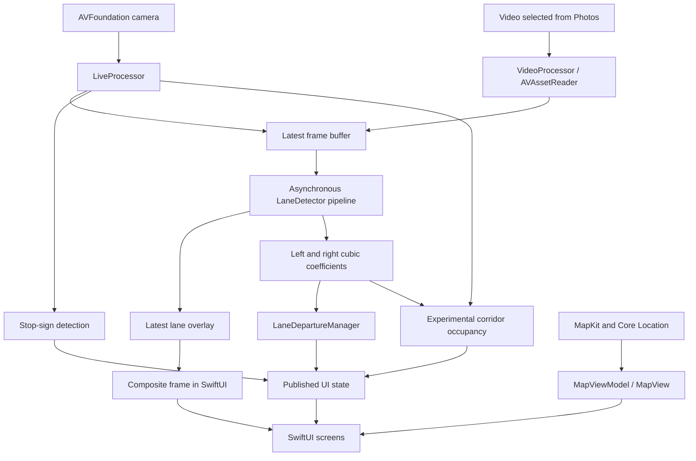

# Architecture

This iOS project combines a neural lane-detection model with custom image processing and Metal compute kernels. SwiftUI presents the processed camera feed alongside MapKit navigation; a separate video tab exercises the lane pipeline on a recording selected from Photos.

The repository preserves the original processing algorithms. This document describes the implemented data flow; [limitations](LIMITATIONS.md) distinguishes prototype behavior from capabilities that still need validation.

## Application structure

| Component | Responsibility |
| --- | --- |
| [`Video_Lane_TestApp.swift`](../Video_Lane_Test/Video_Lane_TestApp.swift) | SwiftUI entry point and the “Image” and “Video” tabs. |
| [`ContentView.swift`](../Video_Lane_Test/ContentView.swift) | Map search, navigation controls, live-camera panel and detection indicators. |
| [`LiveProcessor.swift`](../Video_Lane_Test/LiveProcessor.swift) | AVFoundation camera capture, image conversion and coordination of live detectors. |
| [`VideoProcessor.swift`](../Video_Lane_Test/VideoProcessor.swift) | Photos video import, AVAssetReader frame extraction and lane processing. |
| [`LaneDetector.swift`](../Video_Lane_Test/LaneDetector.swift) | LaneNet inference, mask cleanup, embedding clustering, lane selection, cubic fitting and overlay composition. |
| [`LaneDeparture.swift`](../Video_Lane_Test/LaneDeparture.swift) | Image-space lane-width estimation, center calibration and departure state. |
| [`StopSignDetector.swift`](../Video_Lane_Test/StopSignDetector.swift) | Stop-sign detection with a Core ML model through Vision. |
| [`LaneCollision.swift`](../Video_Lane_Test/LaneCollision.swift) | Experimental human/animal detection and lane-corridor occupancy test. |
| [`Maps/`](../Video_Lane_Test/Maps) | MapKit rendering, destination search, routing and Core Location updates. |



Each processor owns its own `LaneDetector` and `LaneDepartureManager`; the diagram shows their shared design, not a single detector shared between tabs. Only the live processor instantiates the sign and corridor detectors.

## Lane pipeline

### Model input and outputs

The bottom 60% of a frame is cropped and resized to 512 × 256. RGB channels are normalized with `(channel - 127.5) / 127.5`. The LaneNet package is accessed through Xcode's generated Core ML classes.

| Feature | Shape | Type | Meaning in the application |
| --- | --- | --- | --- |
| `lanenet_input_tensor` | `[1, 256, 512, 3]` | Float32 | Normalized RGB input in NHWC order. |
| `lanenet_final_binary_output` | `[256, 512]` | Float32 | Lane/non-lane output, thresholded at 0.5 by post-processing. |
| `lanenet_final_pixel_embedding_output` | `[256, 512, 4]` | Float32 | Four embedding values per pixel, used to group lane pixels. |

The Swift conversion code reads output memory as contiguous arrays. The required model contract therefore includes layout as well as feature names and shapes.

### Post-processing and fitting

| Stage | Implementation | Execution |
| --- | --- | --- |
| Mask cleanup | Threshold; vImage dilation followed by erosion using the declared 5 × 5 kernel; remove eight-connected components smaller than 100 pixels. | CPU / Accelerate |
| Embedding collection | Gather four-dimensional embeddings and image coordinates for retained mask pixels. | CPU |
| Density clustering | Mark core points, initialize labels, then propagate smaller labels through nearby core points for ten passes. | Metal |
| Ego-lane selection | Compare each cluster's mean x coordinate in the lower 35% of the model image; choose the nearest candidate on each side of the image center. | CPU |
| RANSAC hypotheses | Randomly select four points and solve a cubic for each valid sample. | CPU |
| RANSAC scoring | Evaluate each model/point pair, mark inliers and sum inlier counts per model. | Metal |
| Final fit | Refit the winning inlier set using cubic least squares. | CPU |
| Rendering | Rasterize fitted segments with Bresenham, write colored points into a transparent Metal texture, then resize and composite the overlay. | CPU + Metal |

The custom clustering implementation is DBSCAN-style core-point clustering. It uses a radius of 0.35 in embedding space and at least 800 neighboring points to mark a core point. Non-core points remain unassigned; label propagation runs a fixed number of passes. These details matter when comparing its output with a conventional DBSCAN implementation.

The fitted polynomial is **y = Ax³ + Bx² + Cx + D**. RANSAC generates 200 valid hypotheses in batches of 50 and scores them with an absolute vertical residual below three model-image pixels. The final least-squares fit uses the best hypothesis's inliers. Model generation and refinement remain on the CPU; the GPU performs scoring and reduction. See [CubicRANSACKernel.metal](../Video_Lane_Test/CubicRANSACKernel.metal) and [DBSCANKernel.metal](../Video_Lane_Test/DBSCANKernel.metal).

### Coordinate systems

Lane coefficients describe the 512 × 256 cropped model image. For a frame of width `W` and height `H`, overlay placement maps model coordinates back as:

```text
x_frame = x_model × W / 512
y_frame = 0.4 × H + y_model × (0.6 × H) / 256
```

The overlay is transformed for display, while the stored coefficients remain in model coordinates. `LaneDepartureManager` uses that same 512 × 256 domain. The corridor detector currently uses a different 1280 × 720 domain without the corresponding coefficient conversion; see [known limitations](LIMITATIONS.md#coordinate-and-state-consistency).

## Frame scheduling and state

`feedFrame` replaces the newest pending frame and immediately returns a composite using the latest available overlay. A background loop takes the pending frame and runs the lane pipeline. Newer arrivals can replace frames that have not yet entered processing, keeping the pending queue to one frame.

The displayed image and departure checks therefore need not correspond to the same inference timestamp. Lane coefficients are read separately from the overlay. The implementation includes a two-second wait timeout, but that timeout does not cancel the dispatched pipeline. These characteristics are relevant to latency, state consistency and reproducible tests.

Video playback schedules the next frame read after 33 ms; it does not synchronize to the video's presentation timestamps. This scheduling interval is not a measured inference frame rate.

## Departure and object detectors

Departure logic searches the fitted curves at y = 200 and y = 180. Stable observations update a rolling lane-width estimate and calibrate the image-space vehicle center after 20 qualifying calls. If one boundary is missing, the learned width can estimate the other. An offset exceeding 0.4 times the half-width for five qualifying calls produces a departure state. The two width-history buffers currently receive the same averaged width. See [configuration](CONFIGURATION.md) for the exact constants and [limitations](LIMITATIONS.md) for debounce behavior.

During live capture, stop-sign processing runs every third camera frame. The stop model is checked for label `"3"` with a 0.5 confidence threshold.

The corridor path uses `VNDetectHumanRectanglesRequest` and `VNRecognizeAnimalsRequest`. Their requests execute on a serial queue. Each detected object's bounding-box bottom-center is tested against a four-corner lane corridor, followed by a three-call debounce. This is an experimental image-space occupancy heuristic; it contains no distance or time-to-collision calculation.

## Navigation and presentation

`MapViewModel` debounces destination search by 300 ms, resolves a selected search completion and asks MapKit for automobile routes. It selects the returned route with the shortest expected travel time. Core Location supplies position and current speed, displayed in miles per hour; active navigation enables location updates and heading-based map tracking. A polyline-distance check requests a new route when the position is more than 50 m from the current route.

The displayed route distance and “ETA” are the route's distance and expected travel duration at calculation time. The app does not implement spoken turn-by-turn instructions. Starting navigation reveals the live camera panel; its appearance and disappearance start and stop capture.

The live navigation screen displays lane-departure and corridor indicators. The stop-sign detector runs, but its indicator invocation is commented out in the preserved UI. Selected-video mode displays lane overlays and departure messages, without sign detection, corridor detection or navigation.

## Framework boundaries

The application uses Apple frameworks: SwiftUI/UIKit for presentation; AVFoundation and PhotosUI for media; Core ML and Vision for inference and recognition; Metal/MetalKit for custom compute; Accelerate for morphology; and MapKit, Core Location and Combine for navigation and state. The two bundled models are LaneNet and the stop-sign detector. Model training and conversion are separate from application execution. The app performs inference using the supplied model artifacts; it does not train models on-device.
