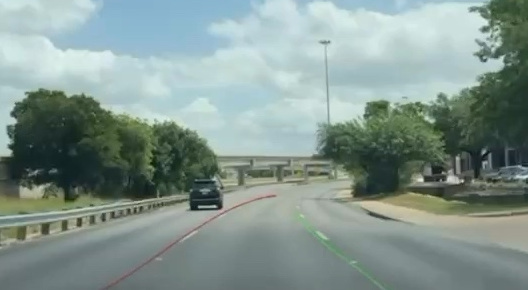

# Demonstration

The README's four-panel overview uses authentic excerpts from the original
**2025 university project presentation**. Each preview loops independently and
links to a muted MP4 of the same duration. Daylight lanes and navigation show
the same section of one drive; night lanes and stop-sign recognition are separate
recorded examples, not simultaneous camera feeds.

| Panel | Open the clip | What it shows |
| --- | --- | --- |
| Daylight lane tracking | [20-second MP4](../assets/demo/daylight.mp4) | Original red left-lane and green right-lane estimates on a curved road |
| Night-time lane tracking | [12-second MP4](../assets/demo/night.mp4) | The lane overlay on a road illuminated by headlamps |
| Stop-sign recognition | [10-second MP4](../assets/demo/stop-sign.mp4) | A stop-sign approach and a separate crop of the original warning region |
| Live navigation | [20-second MP4](../assets/demo/navigation.mp4) | A moving route map with the original ETA, distance, GPS speed and navigation controls |

The stop panel preserves the recorded warning appearing and disappearing. Its
inset is taken from the **same source frame** as the camera view. It is an original
UI crop, not a reconstructed or newly generated detection. The navigation panel
likewise combines the original map and controls from the same frame; it does not
demonstrate a new search, a start/stop interaction or off-route recalculation.

## Historical footage and current functionality

These clips show the historical application, whose exact build identity was not
recorded with the presentation. They do not establish that the current repository
revision produced the recording or passed a new device test.

The historical stop-sign indicator is visible in the video. In the retained
source, stop-sign inference runs but the indicator invocation in `ContentView`
is commented out. The removed speed-limit recognition experiment is not included
in this portfolio; its old badge is excluded from the new crops. The navigation
panel's **current speed** is the separate GPS-derived display that remains in the
application.

The overlays retain their original variation, dropouts and imperfections. These
are qualitative examples, not an accuracy or throughput evaluation. The MP4s'
30 fps and previews' 10 fps are media playback rates, not inference measurements.
The [validation record](VALIDATION.md) describes the checks actually performed on
the maintained source.

## Source and editing record

All demonstration assets originate from the owner-supplied `screencast.mp4.mov`
(1920 × 1080, 516.4 seconds). The presentation identifies the work as a May 2025
university project. The original recording is retained outside this repository.

Source SHA-256:

```text
f8f57e293746c9f3146b081135f2b36b787d8cc471cc8a8b5ba37089d3308a5e
```

Crop coordinates are `(x, y, width, height)` in source pixels, measured from the
top-left corner. Time ranges use presentation timestamps with an exclusive end.

| New asset pair | Source time | Source crop(s) |
| --- | --- | --- |
| `daylight.mp4` / `daylight.webp` | 06:20.000–06:40.000 | Camera `(966, 142, 528, 290)` |
| `night.mp4` / `night.webp` | 07:00.000–07:12.000 | Camera `(912, 340, 784, 428)` |
| `stop-sign.mp4` / `stop-sign.webp` | 03:55.000–04:05.000 | Camera `(924, 158, 632, 352)`; warning region `(1016, 942, 88, 80)` |
| `navigation.mp4` / `navigation.webp` | 06:20.000–06:40.000 | Map `(934, 480, 576, 296)`; controls `(954, 948, 554, 106)` |

Each MP4 is 640 × 432, H.264, 30 fps, with no audio. The corresponding animated
WebP is 480 × 324 at 10 fps and loops at its natural duration. WebP keeps the four
longer previews compact enough to load together. The four previews total about
3.1 MB; the higher-frame-rate MP4s are available by clicking each panel.

The source was trimmed, cropped, scaled and re-encoded with FFmpeg. Neutral
backgrounds and explanatory text were added around the crops. The stop-warning
crop is placed beside its label below the camera image. The navigation map is
placed above a separately cropped controls strip, omitting the old badge row.
These are editorial layouts, not screenshots of a redesigned application.

Playback timing is preserved. There is no retiming, frame interpolation, added
freeze-frame, detection redrawing or algorithm-result correction. No new lane
curves, signs or warnings were generated. The original presentation may itself
contain repeated or held screen-recording frames.

The crops exclude the presenter webcam, slide text, phone status information,
typed destination and removed speed-limit badge. Public-road map labels remain
visible in the navigation crop as part of the recorded app. Audio and original
file metadata are not included in the exports.

## Earlier standalone excerpt

The original portfolio's camera-only lane clip and still images remain available
for a closer look at the lane output:

[](../assets/demo/lane-demo.mp4)

[20-second camera-only MP4](../assets/demo/lane-demo.mp4) ·
[Original six-second GIF](../assets/demo/lane-preview.gif)

| Earlier asset | Source time | Source crop | Delivered format |
| --- | --- | --- | --- |
| `lane-demo.mp4` | 06:20.000–06:40.000 | `(966, 142, 528, 290)` | 528 × 290; 20 seconds; 30 fps; no audio |
| `lane-preview.gif` | 06:20.000–06:26.000 | `(966, 142, 528, 290)` | 480 × 264; 6 seconds; 10 fps; looping |
| `lane-preview.jpg` | 06:20.000 | `(966, 142, 528, 290)` | 528 × 290 |
| `lane-curve.jpg` | 06:35.000 | `(966, 142, 528, 290)` | 528 × 290 |
| `lane-night.jpg` | 07:05.000 | `(912, 340, 784, 428)` | 784 × 428 |

The earlier MP4 was trimmed, cropped, muted and re-encoded with AVFoundation.
Its stills and GIF came from the same source without modifying detections.

## Reproducing the app demonstration

Follow [SETUP.md](SETUP.md) to build the app. A new recording should identify the
exact commit, Xcode version, iOS version and device used. Keep a new device-run
recording separate from these historical assets so its provenance remains clear.

For a repeatable first check, use selected-video mode with footage you have
permission to use. That path exercises lane detection and departure state;
additional camera-only features require a physical-device session. Record visible
failures as well as successful examples, without treating selected clips as an
evaluation dataset.
