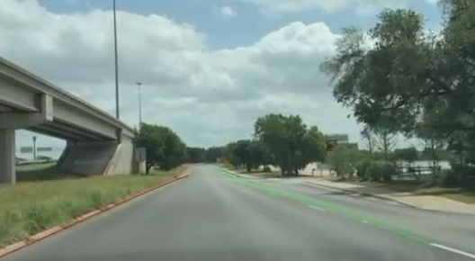
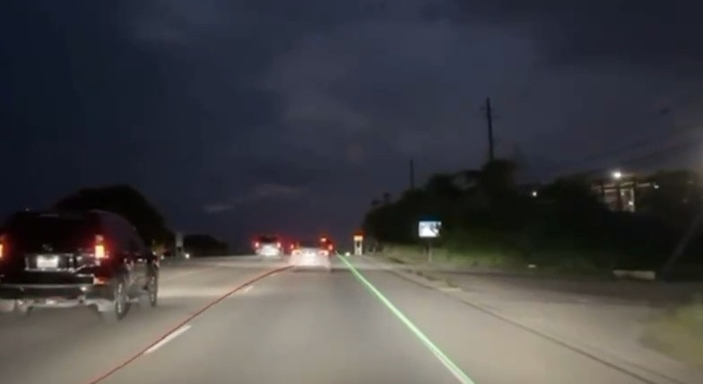

# Demonstration

These are authentic excerpts from the original **2025 university project presentation**. They show the recorded camera preview with the app's red left-lane and green right-lane estimates. They are historical evidence of the original demonstration; they do not establish that this repository revision produced the recording or passed a current device test.

[](../assets/demo/lane-demo.mp4)

[Watch the 20-second muted clip](../assets/demo/lane-demo.mp4) · [View the 6-second animated preview](../assets/demo/lane-preview.gif)

The preview is cropped to the camera region. Navigation, warning indicators, sign recognition, and other interface elements are outside this crop. The overlays are the recorded algorithm output, with their original variation and imperfections. These clips are qualitative examples, not accuracy or throughput benchmarks. The MP4's 30 fps is its presentation-video frame rate, not a measurement of inference speed.

## Additional frames

| Daylight continuation | Night-time example |
| --- | --- |
|  |  |

## Provenance and editing

All five assets originate from the owner-supplied `screencast.mp4.mov` (1920 × 1080, 516.4 seconds). The presentation identifies the project as a May 2025 university project. The original recording is retained outside this repository.

Source SHA-256:

```text
f8f57e293746c9f3146b081135f2b36b787d8cc471cc8a8b5ba37089d3308a5e
```

Crop coordinates below are `(x, y, width, height)` in source pixels, measured from the top-left corner. Time ranges use presentation-video timestamps and an exclusive end time.

| Asset | Source time | Source crop | Delivered format |
| --- | --- | --- | --- |
| `lane-demo.mp4` | 06:20.000–06:40.000 | `(966, 142, 528, 290)` | 528 × 290; 20 seconds; 30 fps; no audio |
| `lane-preview.gif` | 06:20.000–06:26.000 | `(966, 142, 528, 290)` | 480 × 264; 6 seconds; 10 fps; looping |
| `lane-preview.jpg` | 06:20.000 | `(966, 142, 528, 290)` | 528 × 290 |
| `lane-curve.jpg` | 06:35.000 | `(966, 142, 528, 290)` | 528 × 290 |
| `lane-night.jpg` | 07:05.000 | `(912, 340, 784, 428)` | 784 × 428 |

The MP4 was trimmed, cropped, muted, and re-encoded with macOS AVFoundation. The still images were extracted and cropped from the same source. The GIF uses frames from the exported MP4, downsampled in size and frame rate with palette compression. Playback timing is preserved; no detections were redrawn, interpolated, corrected, or generated.

The crops exclude slide text, the presenter webcam, phone status information, and the navigation map. Original presentation slides and profiling screenshots are not used as benchmark evidence.

## Reproducing the app demonstration

Follow [SETUP.md](SETUP.md) to build the app. A new recording should identify the exact commit, Xcode version, iOS version, and device used. Keep a new device-run recording separate from these historical assets so its provenance remains clear.

For a repeatable first check, use the app's selected-video mode with footage you have permission to use. That path exercises lane detection and departure state; the additional camera-only features require a physical-device session. Record any visible failures as well as successful examples, without presenting selected clips as an evaluation dataset.
